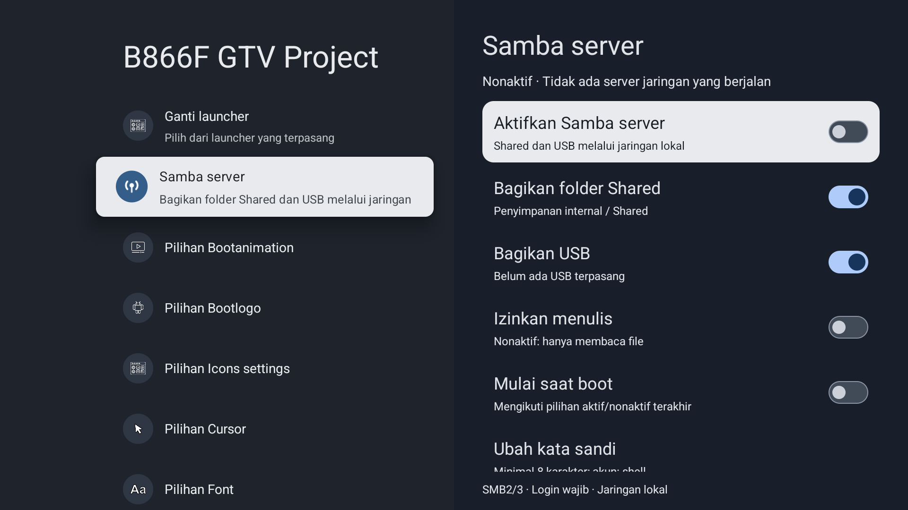

# B866F GTV Project

Kustomisasi Google TV untuk **ZTE B866F V1.1 dengan basis EBS Project Android 14**. Dokumentasi utama dalam Bahasa Indonesia.

**Rilis awal: pratinjau untuk pengembang.** Diuji pada satu STB. Ini kumpulan kode dan alat untuk merakit perubahan, bukan firmware universal atau ROM siap flash. Firmware, kernel, aplikasi Google, dan alat berbayar milik pihak lain tidak disertakan.

## Fitur

- Tampilan Settings dua panel, perbaikan jarak baris, fokus, ikon, dan sakelar.
- [Aplikasi GTV](docs/DRAWER-APLIKASI.md): drawer mandiri dengan pencarian, favorit, aplikasi tersembunyi, dan pilihan grid; diuji berdampingan dengan drawer lama.
- Menu **B866F GTV Project → Ganti launcher**: mendeteksi launcher HOME yang terpasang, memilih default, dan menghentikan launcher sebelumnya setelah pilihan baru terverifikasi. Komponen HOME yang dinonaktifkan oleh alat dicatat untuk pemulihan.
- Menu **Samba server**: berbagi folder internal `Shared` dan USB secara terpisah, kata sandi, akses tulis opsional, dan mulai saat boot opsional.
- Layanan kompatibilitas profil lokal untuk Google TV Home **1.0.994451607**. Hanya launcher dengan paket dan sertifikat Google yang sesuai dapat memanggil layanan. Profil anak/multi-profil belum didukung.
- [Panel notifikasi](docs/NOTIFIKASI.md) dengan overlay routing yang bertahan setelah reboot, sehingga System UI tidak perlu dimulai ulang saat Home memuat pada boot berikutnya. [Kartu popup](docs/KARTU-NOTIFIKASI.md) adalah komponen opsional terpisah.

Samba memakai SMB2/3, login wajib, signing wajib, dan pembatasan jaringan lokal. Kondisi awal: **server mati, akses tulis mati, mulai saat boot mati**. Tidak ada port router yang dibuka.

## Catatan riset kernel dan keamanan

**17 Oktober 2026: upaya upgrade kernel dan patch keamanan penuh dihentikan.**
Eksperimen menghasilkan beberapa pengujian emulator yang berhasil, tetapi belum
membuktikan kompatibilitas seluruh driver B866F, Android, DRM/Netflix, maupun
cakupan patch Mei 2026. Tidak ada hasil eksperimen ini yang dipasang sebagai
pembaruan kernel atau keamanan pada STB, dan tidak ada paket upgrade siap pakai.
Fokus proyek sekarang adalah kustomisasi dan stabilitas Google TV.

[Hasil riset kernel](kernel/POST_QEMU.md) dan [audit keamanan](security/README.md)
dipertahankan sebagai arsip teknis, bukan tracker atau rencana pengembangan aktif.

## Kompatibilitas yang benar-benar diuji

| Komponen | Basis pengujian |
|---|---|
| STB | B866F V1.1, Amlogic S4 / oppen |
| OS | EBS Android 14, `EBS.UKG3.250115.001.eng.ztestb.20250704.161752` |
| Vendor build | `V89511304.1018` |
| Kernel | `5.15.153-android14-11-maybe-dirty` |
| Patch keamanan | 1 Mei 2025 |
| Google TV Home | 1.0.994451607 / 831927, aplikasi Google asli |
| Settings target SHA-256 | `b798e976ac4fea52d39c30f98845682bf20bbbe06224e4c592b4f43165197d1f` |

Nama proyek adalah nama kustomisasi Google TV pribadi untuk B866F. Firmware dasarnya tetap karya EBS dan komponen pihak lain tetap milik pembuatnya.

## Mulai dari sini

1. Baca [panduan instalasi](docs/INSTALASI.md). Siapkan recovery yang sudah diuji sebelum perubahan yang membutuhkan reboot.
2. Pasang dependensi pengembangan dan siapkan berkas lokal sesuai [panduan build](docs/BUILD.md).
3. Jalankan `python tools/preflight.py --serial ALAMAT_ADB`. Pemeriksaan ini hanya membaca informasi perangkat.
4. Rakit APK/helper dan paket modul lokal. Tidak ada unduhan ROM Google atau firmware EBS otomatis.
5. Ikuti instalasi manual bertahap. Simpan launcher lama sampai launcher baru dapat dibuka dan dinavigasi.

Tidak ada installer satu klik untuk semua B866F. Pemeriksaan APK Settings sengaja ketat karena ID resource berbeda antar-ROM.

## Samba

Buka **Settings → B866F GTV Project → Samba server**. Aktifkan server lalu buka **Cara menghubungkan** untuk melihat IP, akun `shell`, dan kata sandi. Di File Explorer Windows masukkan alamat yang ditampilkan, misalnya `\\IP-STB\Shared` atau `\\IP-STB\USB`.

- `Shared` adalah `/storage/emulated/0/Shared`, bukan seluruh penyimpanan internal.
- `USB` berisi direktori volume dari `/mnt/media_rw`.
- **Izinkan menulis** mengizinkan unggah, ubah, dan hapus. Biarkan mati jika hanya ingin membaca.
- Kata sandi tidak dicantumkan dalam repo. Pengaturan disimpan privat pada perangkat.

Pengujian: login Windows dan daftar share berhasil; kata sandi salah ditolak; mode baca menolak unggah; unggah/unduh 2 MiB cocok, nama Unicode, rename, dan hapus berhasil. USB fisik belum diuji karena tidak ada drive terpasang. Autostart diuji dengan restart controller, belum reboot penuh setelah penambahan Samba.

## Pemulihan, laporan masalah, dan kontribusi

Lihat [pemulihan dan rollback launcher/Settings/notifikasi](docs/PEMULIHAN.md), [catatan keamanan](SECURITY.md), dan [kontribusi](CONTRIBUTING.md). Jangan unggah dump perangkat, kata sandi, private key, serial perangkat, token ADB, atau log akun Google ke issue.

Kode proyek dan adaptasi yang dicakup dilisensikan Apache-2.0, kecuali berkas yang menyebut lisensi lain (konfigurasi kernel memakai GPL-2.0-only); lihat [LICENSE](LICENSE) dan [NOTICE](NOTICE). Samba dan dependensinya diambil dari Termux saat build lokal, memakai lisensi masing-masing. Google TV, Android TV, ZTE, dan EBS tidak mensponsori proyek ini.

English: experimental developer preview for one tested B866F firmware base. Indonesian documentation is authoritative. No proprietary firmware/Google APKs, kernel update, or security-patch upgrade is distributed.
